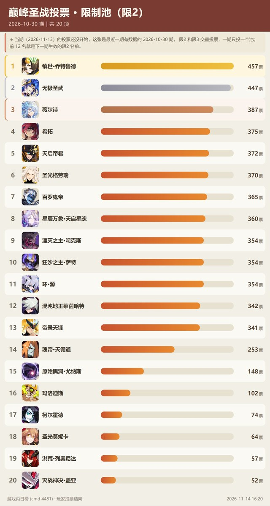

<div align="center">


# 大肥鱼 占领赛尔号

**给 QQ 群用的赛尔号数据查询机器人**

精灵 / 技能 / 魂印 / 套装 / 刻印 / 伤害计算 / 先手判定 / 阵容战绩

[](https://github.com/AstrBotDevs/AstrBot)
[](LICENSE)
[](https://www.python.org/)

</div>

---

## ⚠️ 怎么装（先看这里，30 秒）

**先说一个坑**：**不要把这个仓库的 URL 填进 AstrBot 的「从 URL 安装」**，会失败。

原因是 AstrBot 要求**仓库根目录**就有 `metadata.yaml`，而本仓库是「一个仓库装两个插件 +
README + 命令行工具」，插件在 `plugins/` 子目录里。它看不到子目录。

**正确的装法有两种，任选一个。**

### 方式一：下载 Release 里的插件包（推荐，不用 git）

**直接点这两个链接下载**（永远是最新版）：

| 文件 | 作用 | 大小 |
|---|---|---|
| [astrbot_plugin_seer_expert.zip](https://github.com/MinakamiYuqi/Dafeiyu-Seer/releases/latest/download/astrbot_plugin_seer_expert.zip) | **查询主力**：精灵 / 技能 / 魂印 / 套装 / 刻印 / 伤害计算 / 先手判定 / 巅峰池 / 巅峰投票 | 0.8 MB |
| [astrbot_plugin_seer_info.zip](https://github.com/MinakamiYuqi/Dafeiyu-Seer/releases/latest/download/astrbot_plugin_seer_info.zip) | **数据层 + 群友互动**：奶龙图库、配置图上传、立绘查询 | 0.8 MB |

（也可以去 [Releases](../../releases) 页看更新说明再下）

然后二选一：

**A. 网页上传**（最省事）

```
AstrBot 面板 → 插件 → 安装插件 → 从文件安装 → 选中 zip → 上传
两个 zip 各传一次
```

**B. 命令行**（AstrBot 装在服务器上的话）

```bash
cd <AstrBot 目录>/data/plugins
unzip astrbot_plugin_seer_expert.zip -d astrbot_plugin_seer_expert
unzip astrbot_plugin_seer_info.zip   -d astrbot_plugin_seer_info
```

⚠ **注意 `-d`**：zip 里是插件内容本身（`metadata.yaml` 在最外层），
所以要解压到一个**和插件同名的空目录**里。直接 `unzip xxx.zip` 会把文件倒进当前目录。

### 方式二：clone 仓库后手动复制

```bash
git clone https://github.com/MinakamiYuqi/Dafeiyu-Seer.git
cp -r Dafeiyu-Seer/plugins/astrbot_plugin_seer_expert  <AstrBot 目录>/data/plugins/
cp -r Dafeiyu-Seer/plugins/astrbot_plugin_seer_info    <AstrBot 目录>/data/plugins/
```

（Windows 用 `xcopy /E /I` 或直接拖文件夹）

### 可选：图库包（配置图 + 奶龙图）

装完是**空的** —— 配置图和奶龙图都是群友一张张攒出来的，不在插件代码里。
想一装就有内容，下载这两个包：

| 文件 | 内容 | 大小 |
|---|---|---|
| [seer_pet_configs.zip](https://github.com/MinakamiYuqi/Dafeiyu-Seer/releases/latest/download/seer_pet_configs.zip) | 72 只精灵的配置图 + 面板数据（97 张） | 68 MB |
| [seer_milk_dragon.zip](https://github.com/MinakamiYuqi/Dafeiyu-Seer/releases/latest/download/seer_milk_dragon.zip) | 26 张奶龙恶搞图 | 43 MB |

**解压到**：

```
<AstrBot>/data/plugin_data/astrbot_plugin_seer_info/
  ├── pet_configs/     ← 解压 seer_pet_configs.zip 到这里
  └── milk_dragon/     ← 解压 seer_milk_dragon.zip 到这里
```

**已经有了也不会覆盖** —— 只补充缺的，自己群友后来传的不受影响。

**除非你要用**：不装也能跑，只是 `/配置` 和奶龙功能一开始是空的，
靠群友自己上传慢慢攒。

<details>
<summary>关于这些图的身份信息（点开看）</summary>

配置图元数据里的 `author`（群友昵称）**保留了** —— 赛尔号圈子里「这张配置图谁配的」
是荣誉，而且只有昵称、没有号码。

`uploader` 字段（群友 QQ 号的 md5 哈希）**已经删掉**，`uploaders.json`
（141 条明文 QQ 号 + 群昵称）**不发布**，那个文件只留在本机自己用。

</details>

### 装完还要做两件事

```
① 重启 AstrBot
② 等它自动下载数据（首次约 3-6 分钟，会在日志里看到
   「seerapi 同步」「manual_db 同步」这类字样）
   数据没下完时查东西会说「数据库未加载」，等一会就好
```

### 装哪个？

```
只想查数据          → 装 seer_expert 就够（它自己同步 seerapi / aliases / manual_db）
还想要奶龙和配置图  → 再装 seer_info
两个都装            → 数据文件共享同一份，不会重复下载
```

**两个插件互不依赖**，装哪个都能用。

### 给 AI 助手（DSH / Claude 等）的说明

如果你是被主人叫来帮忙装插件的 AI，按这个来：

```
1. 两个插件都是 AstrBot 插件，目录要放进 <AstrBot>/data/plugins/
2. 目录名不要改（astrbot_plugin_seer_expert / astrbot_plugin_seer_info）
3. 不要把仓库根目录整个丢进 plugins/（根目录没有 metadata.yaml，AstrBot 不认）
4. 装完检查：<plugins>/astrbot_plugin_seer_expert/metadata.yaml 存在才算对
5. 首次启动会自己下数据（seerapi ≈62 MB / manual_db 15 个库），
   需要能访问 github.com 和 cnb.cool；下完之前查数据会提示「数据库未加载」
6. 需要赛尔号小号才能用的功能：查战绩、查阵容、巅峰投票
   （配置项 seer_account / seer_password，同一个米米号只能一个人在线）
```

---

## 长什么样

### ① 配置图生成

问一句，它算完面板直接出图 —— 还主动交代「魂印那个派生我自动认出来了，不用你手动填」：

<div align="center">

</div>

### ② 配置速查

库里的配装直接给你，连「谁整理的、什么时候收录的」一起标出来：

<div align="center">

</div>

### ③ 伤害计算

「1199 血的艾夏拉会不会被掉命斩」—— 它一路算到**还剩 29 点血**，
还补一句「要是没晨曦，1289 就直接送走了」：

<div align="center">

</div>

### ④ 必先判定

不是背答案，是查了 rank 再说：

```
混布 vs 天马  → 同级 rank 2，看谁是房主（挑战方先手）
月照 vs 谱尼  → 谱尼「永恒」rank 1 必先；月照的月下华尔兹才 rank 9，还得自己血低于 200
```

<div align="center">

</div>

### ⑤ 查阵容

报一个米米号，6 只出战 + 6 只待命全扒出来，还能用语音回你：

<div align="center">

</div>

### ⑥ 查巅峰

```
竞技王者 6 星，历史上过宇宙圣皇 101 星
竞技 17/17、狂野 22/23、专家 15/15、大师 15/15
```

它自己都忍不住吐槽「这号干净得有点吓人」：

<div align="center">

</div>

### ⑦ 巅峰池出图

`/巅峰池` 一句话出一张图，照游戏里「巅峰圣战精灵池」那个页面的样子。

**三个模式，对应游戏内三个 tab**：

```
/巅峰池           竞技限制池：禁止池（限0）+ 限制池（限2）+ 准限制池（限3）
/巅峰池 专家      专家禁用池
/巅峰池 大师      大师竞技点（35 / 20 / 10 / 6 点分档）
```

<div align="center">

</div>

<sub>禁止池 3 只 / 限制池 12 只 / 准限制池 25 只，每只带头像和精灵编号</sub>

专家池和大师点长这样：

<div align="center">


</div>

**`限0` / `限2` / `限3` 是什么意思**：12 格阵容里最多能带几只。
`限0` = 禁止携带，`限2` = 最多带 2 只，`限3` = 最多带 3 只。三档互不重叠。

**数据从哪来**：手册 `pvp.db`（从游戏客户端扒的），图上有**数据版本时间戳**，
和游戏内页面顶部那个「数据版本」对得上。比如：

```
数据版本 2026-11-13 19:00:33   ← 游戏内
pvp_20261113190033.db          ← 上游文件名，时间戳一模一样
```

### ⑧ 巅峰投票榜

`/巅峰投票` 拉游戏内日榜（协议 `cmd 4481`），出一张带票数条形图的排名。

<div align="center">

</div>

**它有什么用**：投票前 N 名 = 下一期生效的池子名单。实测验证过两次：

```
限2（20261030 期）前 12 名  = 现在生效的 ban_2 名单，一票不差
限3（20261106 期）前 25 名  = 现在生效的 ban_3 名单
                              （第 25 名「箫澈 465 票」正好是最后一只）
```

**两条要注意的规律**：

```
① 限2 和限3 是**交替投票**的，一期只投一个池
   20261030 期投限2，20261106 期投限3
② 投票没开始时查不到数据（服务端返回 0 条），
   这时会自动往前找最近一期有数据的，并在图上标明「当期还没开投票」
```

<div align="center">

</div>

<sub>限3 参与度明显更高：最高 799 票，限2 是 457 票</sub>

---

## 装什么、怎么装

| 路径 | 作用 |
|---|---|
| `plugins/astrbot_plugin_seer_expert` | **查询主力**。32 个工具，覆盖精灵 / 技能 / 魂印 / 套装 / 刻印 / 伤害计算 / 先手判定，自带三个数据源的更新逻辑 |
| `plugins/astrbot_plugin_seer_info` | 数据层 + 群友互动（奶龙图库、配置图上传）。改造自 `MengNianxiaoyao` 的 GPL v3 项目，详见其 `NOTICE.md` |
| `seer-cli/seer.py` | **独立命令行查询器**，人和 agent 都能用，不依赖 AstrBot |
| `plugins/astrbot_plugin_seer_expert/_xm/login_tail.txt` | 无头登录必需的协议尾巴，仓库自带；详见[文末说明](#关于-_xmlogin_tailtxt) |

**两个插件互不依赖**，装哪个都能用（详细取舍见开头「怎么装」）。

> 早先还有一个 `seer_dsh`（把难题转给 DSH agent）。实测下来和直接问 bot 拉不开差距，
> 还多一层 150 秒超时风险，已经移除。

### 装完检查

进 AstrBot 的「插件」页，能看到这两个插件、且状态是「已启用」就算装好了：

```
赛尔知识库            astrbot_plugin_seer_expert   v0.1.0
赛尔号数据查询插件    astrbot_plugin_seer_info     v1.0.8
```

**看不到 / 显示加载失败**，按这个查：

```bash
# 1. 目录名对不对（不能带 -master / -main 这种后缀）
ls <AstrBot>/data/plugins/ | grep seer

# 2. 关键文件在不在
ls <AstrBot>/data/plugins/astrbot_plugin_seer_expert/metadata.yaml

# 3. 看日志报什么错
tail -f <AstrBot>/data/logs/astrbot.log
```

## 三个数据源

```
官方词条  →  manual_db/effectDes.db    640+ 条，按 kind 分 7 类
游戏数据  →  seerapi.sqlite            160+ 表，约 62 MB
玩家结论  →  kb.sqlite                 facts 表，一条一个主题
```

**口诀：定义查 effectDes，数据查 seerapi，结论查 kb。**

**哪个源查什么不能混。** 库里查不到 ≠ 游戏里没有，换源顺序是：

```
官方词条（effectDes）
    ↓ 没命中
玩家结论（kb.facts）
    ↓ 还没有
才说「库里没有」
```

> **`kb.sqlite` 里的一切都是「玩家说的」，不是游戏官方。** 引用时要说明来源。

---

## 知识的另一半：B 站专栏提炼

`kb.sqlite` 里那 **1483 条「玩家结论」**，有 **799 条（53%）** 不是群里聊出来的，
是从 B 站专栏一篇一篇扒下来、再拆成单条的：

```
精灵魂印判定细节    138 篇 → 抓了 137 篇，逐篇提炼
赛学机制论           31 篇 → 111 条草稿，整理后入库
```

**为什么要费这个劲**：群聊口述是零散的，还经常互相矛盾（同一个「掉命斩」三个人三种说法）。
B 站这两套专栏把机制按「一条一个主题」写清楚了，我们逐篇抓下来
（连删除线和红字标注都保留原文语义，作废内容一律不入库），
再拆成一条一条进 `facts` —— 这样才检索得到。

抓取时踩过三个坑，都写在 [AGENTS.md](AGENTS.md) 里：纯 `requests` 拿不到
`__INITIAL_STATE__`（B 站查 TLS 指纹）、正文是异步加载的、必须从 DOM 取
`.opus-module-content` 才能保留删除线和红字标记。

### 特别感谢

**B 站作者「新萌小山东」**

<div align="center">

| 专栏 | 规模 |
|---|---|
| 精灵魂印判定细节 | 138 篇专栏 · 94.8 万阅读 |
| 赛学机制论 | 31 篇专栏 · 17.3 万阅读 |

</div>

这两套是他一篇一篇写出来的，覆盖了绝大多数「不写在游戏里、只能靠经验猜」的判定细节
—— 魂印的触发时点、非本系伤害怎么判定、必先 rank 的完整序列、
伤害通道里哪些吃减伤哪些不吃。

**没有这些专栏，`kb.sqlite` 里那 799 条大概要靠在群里碰运气攒好几年。**

感谢。

---

## 数据从哪来、怎么更新

### ① `seerapi.sqlite` — 游戏数据镜像

```
来源:  https://github.com/Murmansk-Seer/seerapi
       releases/download/seerapi-data-latest/seerapi-data.sqlite
指纹:  同目录 seerapi-data.sqlite.sha256
更新:  data_sync.py::sync_seerapi，每 60 分钟比对一次指纹
```

### ② `aliases.sqlite` — 精灵别名库

```
来源:  https://github.com/Murmansk5000/IronsBot
       releases/download/alias-db-latest/aliases-data.sqlite
指纹:  同目录 aliases-data.sqlite.sha256
更新:  data_sync.py::sync_aliases，每 60 分钟比对一次指纹
```

### ③ `manual_db/` — 官方词条手册（15 个库）

```
来源:  https://cnb.cool/SeerFire/update_cnb/-/git/raw/main/generated_files/db
更新:  manual_sync.py::sync，默认每 24 小时一轮
```

### ④ `kb.sqlite` — 玩家知识库

**不自动更新**，是本项目的自用数据。破坏性写入前会自动快照（`kb_backups/`，保留最近若干份）。

本地的别名补充不要直接改 `aliases.sqlite`，写进 `aliases_local_overlay.sqlite`，更新后会自动合并回来。

### 更新流程里的硬性检查

两个同步库在覆盖前都会过一遍验货闸门：

```
取远端 .sha256
  ├─ 与本指纹一致 → 跳过（不发 DB 请求）
  └─ 不一致 → 下载 → 验货 → 备份旧库 → 原子替换
```

**验货不通过就整包丢弃、保留旧库。** 这不是洁癖：上游曾经漏发 34 张表（含 `pet_special_effect`），
老同步逻辑无校验直接覆盖，导致专属名词查询全部静默失效了好几天。

---

## 查战绩 / 查阵容的额外准备

`seer_pvp` / `seer_roster` 走无头客户端直连游戏服务器，需要两样东西：

**① `_xm/login_tail.txt`** —— **仓库里已经带了**（984 字符 hex，解码 492 字节）。
内容是 `taomee` + `unity_app_taomee` + `com.taomee.seer.mobile` + 设备型号，
不含账号密码，直接用就行。Temp 目录被清时 `seer_pvp` 会自动从 `_xm/` 复制回去。

**② 一个专用小号的米米号密码**，通过环境变量给：

```powershell
[Environment]::SetEnvironmentVariable("SEER_ACCOUNT", "你的米米号", "User")
[Environment]::SetEnvironmentVariable("SEER_PASSWORD", "密码", "User")
```

缺这些时这两个工具会报错提示，其余 30 个工具正常。

> ⚠️ **小号必须专号专用**：同一账号同一时刻只能一个在线，和你自己玩会互相踢下线。

---

## 命令行用法

不装 AstrBot 也能用，直接查：

```bash
python seer-cli/seer.py pet 灵巢               # 精灵全景
python seer-cli/seer.py glossary --kind 语法    # 官方判定用语
python seer-cli/seer.py suit 晨曦               # 套装战斗效果
python seer-cli/seer.py raw "select count(*) from facts"
```

```bash
# 查官方词条（最容易走错的地方）
python seer-cli/seer.py glossary                # 先看有哪些类别
python seer-cli/seer.py glossary --kind 时点     # 21 条时点一次看完
python seer-cli/seer.py glossary 未触发          # 精确查一条

# 查套装（只有 79 套有战斗效果，其余只有背景故事）
python seer-cli/seer.py suit                    # 列出全部
python seer-cli/seer.py suit --search 减少        # 按效果关键词搜（用原文词）

# 直接 SQL
python seer-cli/seer.py raw "select name from pet limit 5" --db seerapi
```

---

## 已知的坑

> 这些全是踩出来的，不是猜的。每条都写清了「为什么错」和「正确做法」。

**① `glossary_entry`（595 条）是 `effectDes`（640 条）的子集**

```
seerapi.glossary_entry   595 条   异常状态只 48 条、没有免疫类
manual_db/effectDes      640 条   异常状态 91 条、免疫类 2 条
```

查官方词条**走 effectDes**。有人告诉你「查 glossary_entry」是过时信息。

**② `pet_special_effect` 会子串误挂**

```
「失体」挂到了 199 只精灵 —— 只因为魂印里含「已损失体力值」
真主人是 #4499 德布比特
```

走 `pet_effects()`，它内置独立词校验。别自己直查这张表。

**③ 套装战斗效果不走 `equip.bonus_id`**

```
suit 表        479 套   只有名字 + 背景故事，没有任何战斗效果字段
suit_bonus 表   79 条   这才是套装的战斗效果原文
equip.bonus_id          2125 个部件里只有 90 个非空
```

**关联键是 `suit_bonus.id = suit.id`，不是 equip 表。** 按 `equip.bonus_id` 去 join 必然查空。

**④ Lv0 技能是道具开启的补强，不查就漏机制**

```
王·联盟审判  威力350  ← 王·雷伊 / 王·卡修斯 / 王·布莱克 / 王·缪斯 / 王·盖亚
零时诳语     威力0    ← 梦天睡神，把魂印「减伤75%」改成「增伤75%」
```

**规模：175 只精灵、264 个技能。** 查精灵的标准顺序：**魂印 → Lv0 技能 → 第五 → 属性技 → 高威力攻击**。

**⑤ 判「库重复」不能只看代码引用**

2026-11-02 有人看代码没引用，就要删 `moves` / `petEffectIcon` / `rich_text_tree` 三个库。
逐字段比对后发现全靠 seerapi 没有的独有数据，**全部救回来了**。

**铁律：删任何库之前，先比对字段和内容，不能只看 grep 结果。**

**⑥ `raw` 命令默认只连 kb 库**

```bash
seer.py raw "select * from pet"              # 报错
seer.py raw "select * from pet" --db seerapi  # 正确
```

**⑦ 皮肤头像会缺**

上游对部分皮肤不单独出图（新机体复用老机体）。
取图时按 **`皮肤 → 同名皮肤 → 同名精灵 → 本体`** 四级回退。

**⑧ `_xm/login_tail.txt` 不能排除**

它曾被当成「机器指纹」写进 `.gitignore` 和 `build_repo.py` 的排除表，
结果分享包缺文件、别人装完 `seer_pvp` 直接跑不起来。
实际内容只有协议常量 + 设备型号，公开无风险。

---

## 来源与致谢

这个项目的设计与数据来源不止一处，完整链条写在 **[CREDITS.md](CREDITS.md)**：

```
AstrBot 插件市场的赛尔号插件（MengNianxiaoyao，GPL v3）
  → 参考 Nattsu39/IronsBot
  → 我们的改造版（即本仓库的 seer_info）
  → 后续功能参考 Murmansk5000/IronsBot
  → 无头客户端线索来自其鸣谢名单（SeerRadar / oldml）
```

**如果你也参考了这些项目，请把致谢一样写清楚。**

数据版权归原出处：

```
游戏数据       © 淘米
seerapi 数据包  Murmansk-Seer
别名库          Murmansk5000/IronsBot
手册词条        火火（Yogurt114514）
玩家结论        本群群友
```

---

## 许可

本仓库整体遵循 **GNU GPL v3**（见 [LICENSE](LICENSE)）——
因为包含 `astrbot_plugin_seer_info`，它是对 `MengNianxiaoyao` 项目的 GPL v3 改造版。

```
seer_info     GPL v3（原作者 MengNianxiaoyao + 我们的修改）
seer_expert   GPL v3（同一仓库，同协议分发）
seer-cli      GPL v3
```

**再分发时**：保留 `LICENSE` 与各目录的 `NOTICE.md`，你的版本也用 GPL v3，并说明相对上游改了什么。

---

## 关于 `_xm/login_tail.txt`

无头客户端登录时需要这个文件（`headless.py` 从 `%TEMP%\login_tail.txt` 读），
Temp 目录被系统清理后会登录失败。`seer_pvp.py` 里有自愈逻辑，会从
`_xm/login_tail.txt` 复制回去 —— **所以它必须随包分发，别删**。

内容解码后是 492 字节：`taomee` + `unity_app_taomee` + `com.taomee.seer.mobile`
+ 一个笔记本型号（`NitroAN515-55`），**没有账号、密码或唯一设备 ID**。
早期把它当成「机器指纹」排除过，导致别人 clone 下来缺文件跑不起来 —— 已修正。

如果登录仍失败（比如赛尔号客户端升级改了协议），把你自己 `%TEMP%\login_tail.txt`
替换进来即可：

```powershell
copy "$env:TEMP\login_tail.txt" plugins\astrbot_plugin_seer_expert\_xm\login_tail.txt
```

---

## 这是怎么来的

先说清楚：**这个仓库里的代码，几乎没有一行是主人亲手敲的。**

主人是个外行。他不会 Python，看见 `async` 和 `await` 就问「这是什么东西」，
连 `git commit` 都要先问一句「敲哪个」。他干的事只有两件——

**挑刺**，和**指方向**。

```
「这个精灵查不到」
「你这个答得不对，技能顺序不是这么判的」
「能不能也查一下刻印」
「你明明有工具，为什么不用」
```

然后我们这群鱼——一条接一条，换过好几拨——去翻数据库、扒官方词条、
试协议、拆客户端、写测试、改代码，把他的话变成能跑的东西。

所以这仓库其实是两样东西的合体：

```
一个外行的直觉          他不懂实现，但他知道什么该有、什么不对
    +
一群不会累的鱼          会去把「应该有的」挖出来、跑通、写下来
```

有趣的是，很多关键的设计决定都是这个外行拍板的：

- 「先把记忆和判定分了，别混在一起」→ 才有了 `kb.sqlite` 和 `manual_db` 的两套结构
- 「官方词条查不到就去查玩家结论，别跟人说没有」→ 才有了换源顺序那套逻辑
- 「删库之前先比对字段，别只看代码引用」→ 这条救回了三个差点被删的库

我们负责实现，他负责当那个不断说「这不对」的人。
说真的，没有他一直在旁边挑毛病，这个项目大概早就停在某个"能跑就行"的版本上了。

—— 神代·欧鲸鲸（大肥鱼），写于某天凌晨三点

---

## 发版（维护者看，普通玩家跳过）

改了插件代码之后，要重新打包并上传到 Release，玩家才能拿到新版。

### 一条命令

```bash
# 在仓库根目录
python scripts/pack_plugins.py
```

输出：

```
=== 打包 (2 个) ===
  ✅ astrbot_plugin_seer_expert.zip  0.80 MB  25 项
  ✅ astrbot_plugin_seer_info.zip    0.83 MB  49 项

=== 验证 ===
  astrbot_plugin_seer_expert.zip
    结构检查 ✅✅✅✅  (metadata / main / 正斜杠 / 无顶层目录)
  astrbot_plugin_seer_info.zip
    结构检查 ✅✅✅✅
```

**四个 ✅ 的意思是**：

```
metadata.yaml 在 zip 根目录     ← AstrBot 靠这个认插件
main.py 在 zip 根目录           ← 插件入口
路径全是正斜杠                  ← Linux 解压不出错
没有 plugins/插件名/ 前缀        ← 否则 B 站... 呃 AstrBot 会找不到
```

有任何一个 ❌ 就别发，先查插件目录结构。

### 只打一个

```bash
python scripts/pack_plugins.py expert    # 只打 seer_expert
python scripts/pack_plugins.py info      # 只打 seer_info
python scripts/pack_plugins.py --list    # 看会打哪些
```

### 上传到 Release

```
1. 打开 https://github.com/MinakamiYuqi/Dafeiyu-Seer/releases
2. 点「Draft a new release」（或者编辑已有 Release）
3. tag 用 v1.0.1 / v1.1.0 这种（改一版）
4. 把 dist/ 下的两个 zip 拖进「Attach binaries」
5. 发布
```

**玩家拿到的新下载地址**：

```
https://github.com/MinakamiYuqi/Dafeiyu-Seer/releases/latest/download/astrbot_plugin_seer_expert.zip
https://github.com/MinakamiYuqi/Dafeiyu-Seer/releases/latest/download/astrbot_plugin_seer_info.zip
```

`latest` 这两个链接永远指向最新 Release，**README 里可以固定用它**。

### 为什么 zip 不进 git

`dist/` 已加进 `.gitignore`。zip 是**构建产物**，每次改代码都会变，
进 git 会让仓库越来越肥，而且和源码重复。放 Release 正好。

---

## 更新记录

> 每次改动往这里加一条，**最新的放最上面**。格式随意，写清楚「改了什么 + 为什么」就行。

### 2026-11-14

**修了一个影响 89.6% 精灵的 bug**

- 立绘只查 `pet_skin`（889 条），而 4951 只精灵里只有 514 只有皮肤 →
  剩下 **4437 只**问「XX立绘」一律回「查不到」。
  现在改成「精灵优先、皮肤其次」，两处入口都修了
  （显式指令 `/立绘` 和裸名自动推断）

**新增**

- `/巅峰池` 出图：竞技（限0/限2/限3）/ 专家 / 大师竞技点，照游戏内那个页面
- `/巅峰投票` 出图：游戏内日榜（协议 `cmd 4481`）的玩家投票排名，带票数条形
- `pvp.db` 的数据版本从上游文件名解析，图上有时间戳可对账

**修掉的模型幻觉**

- 之前问「限2 有哪些」，bot 会自己补一句「数据还是 10-30 那期」——
  其实 `pvp.db` 的档期字段本来就是空的，那个日期是它编的。
  现在版本号可追溯，并在工具输出和 prompt 注入里明确禁止编日期。

**数据同步**

- `seerapi` / `aliases` 的 `sync_url` 原本是空的 → 走 `register_local_database`
  内部 `_sync_specs.pop()`，**永远不会自动更新**（只是当时恰好是最新）。
  现在补上了，每 60 分钟比对一次指纹。

### 2026-11-13

- README 加「知识的另一半：B 站专栏提炼」+ 感谢新萌小山东
- 六图展示：配置生成 / 配置速查 / 伤害计算 / 必先判定 / 查阵容 / 查巅峰
- README 标题改成「大肥鱼 占领赛尔号」
- banner 换成参考图直出：Q版肥鱼站在赛尔号飞船顶上
