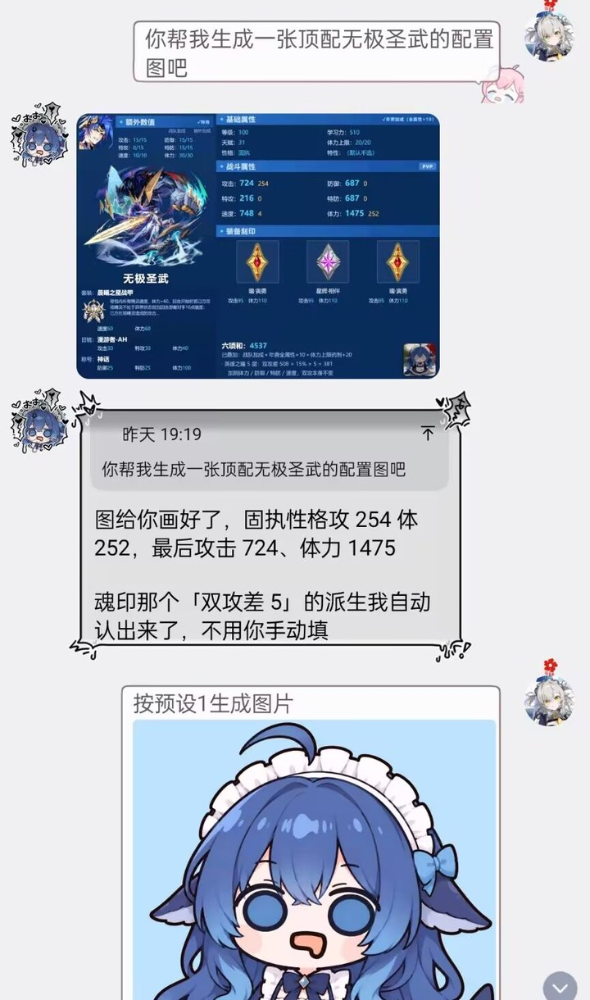

<div align="center">


# 神代·欧鲸鲸

**给 QQ 群用的赛尔号数据查询机器人**

精灵 / 技能 / 魂印 / 套装 / 刻印 / 伤害计算 / 先手判定 / 阵容战绩

[](https://github.com/AstrBotDevs/AstrBot)
[](LICENSE)
[](https://www.python.org/)

</div>

---

## 长什么样

**问「给我画张顶配无极圣武的配置图」——** 它算完面板直接出图，不用你手动填派生：

<div align="center">

</div>

**问规则——** 它会说清楚「为什么」，顺便提醒你别跟相邻的规则搞混：

<div align="center">

</div>

**问伤害——** 能一路算到「还剩 29 点血」，并告诉你「要是没晨曦就直接送走了」：

<div align="center">

</div>

---

## 装什么、怎么装

| 路径 | 作用 |
|---|---|
| `plugins/astrbot_plugin_seer_expert` | **查询主力**。32 个工具，覆盖精灵 / 技能 / 魂印 / 套装 / 刻印 / 伤害计算 / 先手判定，自带三个数据源的更新逻辑 |
| `plugins/astrbot_plugin_seer_info` | 数据层 + 群友互动（奶龙图库、配置图上传）。改造自 `MengNianxiaoyao` 的 GPL v3 项目，详见其 `NOTICE.md` |
| `seer-cli/seer.py` | **独立命令行查询器**，人和 agent 都能用，不依赖 AstrBot |
| `plugins/astrbot_plugin_seer_expert/_xm/login_tail.txt` | 无头登录必需的协议尾巴，仓库自带；详见[文末说明](#关于-_xmlogin_tailtxt) |

**两个插件互不依赖，装哪个都能用**：

```
只想查数据          → 装 seer_expert 就够（它自己同步 seerapi / aliases / manual_db）
还想要奶龙和配置图  → 再装 seer_info
两个都装            → 数据文件共享同一份，不会重复下载
```

> 早先还有一个 `seer_dsh`（把难题转给 DSH agent）。实测下来和直接问 bot 拉不开差距，
> 还多一层 150 秒超时风险，已经移除。

### 三步装好

```bash
# 1. 装 AstrBot
#    https://github.com/AstrBotDevs/AstrBot

# 2. 把两个插件目录复制过去
cp -r plugins/astrbot_plugin_seer_expert <AstrBot>/data/plugins/
cp -r plugins/astrbot_plugin_seer_info   <AstrBot>/data/plugins/

# 3. 重启 AstrBot
```

**首次启动后会自动准备数据**：

| 数据 | 什么时候好 | 说明 |
|---|---|---|
| `seerapi.sqlite` / `aliases.sqlite` | 启动约 3 分钟 | 约 62 MB，耐心等 |
| `manual_db/`（15 个手册库） | 启动约 10 分钟 | 官方词条来源 |
| `kb.sqlite` | **不会自动生成** | 空库也能跑，只是「玩家结论」那部分查不到 |

---

## 三个数据源

```
官方词条  →  manual_db/effectDes.db    640+ 条，按 kind 分 7 类
游戏数据  →  seerapi.sqlite            160+ 表，约 62 MB
玩家结论  →  kb.sqlite                 facts 表，一条一个主题
```

**口诀：定义查 effectDes，数据查 seerapi，结论查 kb。**

**哪个源查什么不能混。** 库里查不到 ≠ 游戏里没有，换源顺序是：

```
官方词条（effectDes）
    ↓ 没命中
玩家结论（kb.facts）
    ↓ 还没有
才说「库里没有」
```

> **`kb.sqlite` 里的一切都是「玩家说的」，不是游戏官方。** 引用时要说明来源。

---

## 数据从哪来、怎么更新

### ① `seerapi.sqlite` — 游戏数据镜像

```
来源:  https://github.com/Murmansk-Seer/seerapi
       releases/download/seerapi-data-latest/seerapi-data.sqlite
指纹:  同目录 seerapi-data.sqlite.sha256
更新:  data_sync.py::sync_seerapi，每 60 分钟比对一次指纹
```

### ② `aliases.sqlite` — 精灵别名库

```
来源:  https://github.com/Murmansk5000/IronsBot
       releases/download/alias-db-latest/aliases-data.sqlite
指纹:  同目录 aliases-data.sqlite.sha256
更新:  data_sync.py::sync_aliases，每 60 分钟比对一次指纹
```

### ③ `manual_db/` — 官方词条手册（15 个库）

```
来源:  https://cnb.cool/SeerFire/update_cnb/-/git/raw/main/generated_files/db
更新:  manual_sync.py::sync，默认每 24 小时一轮
```

### ④ `kb.sqlite` — 玩家知识库

**不自动更新**，是本项目的自用数据。破坏性写入前会自动快照（`kb_backups/`，保留最近若干份）。

本地的别名补充不要直接改 `aliases.sqlite`，写进 `aliases_local_overlay.sqlite`，更新后会自动合并回来。

### 更新流程里的硬性检查

两个同步库在覆盖前都会过一遍验货闸门：

```
取远端 .sha256
  ├─ 与本指纹一致 → 跳过（不发 DB 请求）
  └─ 不一致 → 下载 → 验货 → 备份旧库 → 原子替换
```

**验货不通过就整包丢弃、保留旧库。** 这不是洁癖：上游曾经漏发 34 张表（含 `pet_special_effect`），
老同步逻辑无校验直接覆盖，导致专属名词查询全部静默失效了好几天。

---

## 查战绩 / 查阵容的额外准备

`seer_pvp` / `seer_roster` 走无头客户端直连游戏服务器，需要两样东西：

**① `_xm/login_tail.txt`** —— **仓库里已经带了**（984 字符 hex，解码 492 字节）。
内容是 `taomee` + `unity_app_taomee` + `com.taomee.seer.mobile` + 设备型号，
不含账号密码，直接用就行。Temp 目录被清时 `seer_pvp` 会自动从 `_xm/` 复制回去。

**② 一个专用小号的米米号密码**，通过环境变量给：

```powershell
[Environment]::SetEnvironmentVariable("SEER_ACCOUNT", "你的米米号", "User")
[Environment]::SetEnvironmentVariable("SEER_PASSWORD", "密码", "User")
```

缺这些时这两个工具会报错提示，其余 30 个工具正常。

> ⚠️ **小号必须专号专用**：同一账号同一时刻只能一个在线，和你自己玩会互相踢下线。

---

## 命令行用法

不装 AstrBot 也能用，直接查：

```bash
python seer-cli/seer.py pet 灵巢               # 精灵全景
python seer-cli/seer.py glossary --kind 语法    # 官方判定用语
python seer-cli/seer.py suit 晨曦               # 套装战斗效果
python seer-cli/seer.py raw "select count(*) from facts"
```

```bash
# 查官方词条（最容易走错的地方）
python seer-cli/seer.py glossary                # 先看有哪些类别
python seer-cli/seer.py glossary --kind 时点     # 21 条时点一次看完
python seer-cli/seer.py glossary 未触发          # 精确查一条

# 查套装（只有 79 套有战斗效果，其余只有背景故事）
python seer-cli/seer.py suit                    # 列出全部
python seer-cli/seer.py suit --search 减少        # 按效果关键词搜（用原文词）

# 直接 SQL
python seer-cli/seer.py raw "select name from pet limit 5" --db seerapi
```

---

## 已知的坑

> 这些全是踩出来的，不是猜的。每条都写清了「为什么错」和「正确做法」。

**① `glossary_entry`（595 条）是 `effectDes`（640 条）的子集**

```
seerapi.glossary_entry   595 条   异常状态只 48 条、没有免疫类
manual_db/effectDes      640 条   异常状态 91 条、免疫类 2 条
```

查官方词条**走 effectDes**。有人告诉你「查 glossary_entry」是过时信息。

**② `pet_special_effect` 会子串误挂**

```
「失体」挂到了 199 只精灵 —— 只因为魂印里含「已损失体力值」
真主人是 #4499 德布比特
```

走 `pet_effects()`，它内置独立词校验。别自己直查这张表。

**③ 套装战斗效果不走 `equip.bonus_id`**

```
suit 表        479 套   只有名字 + 背景故事，没有任何战斗效果字段
suit_bonus 表   79 条   这才是套装的战斗效果原文
equip.bonus_id          2125 个部件里只有 90 个非空
```

**关联键是 `suit_bonus.id = suit.id`，不是 equip 表。** 按 `equip.bonus_id` 去 join 必然查空。

**④ Lv0 技能是道具开启的补强，不查就漏机制**

```
王·联盟审判  威力350  ← 王·雷伊 / 王·卡修斯 / 王·布莱克 / 王·缪斯 / 王·盖亚
零时诳语     威力0    ← 梦天睡神，把魂印「减伤75%」改成「增伤75%」
```

**规模：175 只精灵、264 个技能。** 查精灵的标准顺序：**魂印 → Lv0 技能 → 第五 → 属性技 → 高威力攻击**。

**⑤ 判「库重复」不能只看代码引用**

2026-11-02 有人看代码没引用，就要删 `moves` / `petEffectIcon` / `rich_text_tree` 三个库。
逐字段比对后发现全靠 seerapi 没有的独有数据，**全部救回来了**。

**铁律：删任何库之前，先比对字段和内容，不能只看 grep 结果。**

**⑥ `raw` 命令默认只连 kb 库**

```bash
seer.py raw "select * from pet"              # 报错
seer.py raw "select * from pet" --db seerapi  # 正确
```

**⑦ 皮肤头像会缺**

上游对部分皮肤不单独出图（新机体复用老机体）。
取图时按 **`皮肤 → 同名皮肤 → 同名精灵 → 本体`** 四级回退。

**⑧ `_xm/login_tail.txt` 不能排除**

它曾被当成「机器指纹」写进 `.gitignore` 和 `build_repo.py` 的排除表，
结果分享包缺文件、别人装完 `seer_pvp` 直接跑不起来。
实际内容只有协议常量 + 设备型号，公开无风险。

---

## 来源与致谢

这个项目的设计与数据来源不止一处，完整链条写在 **[CREDITS.md](CREDITS.md)**：

```
AstrBot 插件市场的赛尔号插件（MengNianxiaoyao，GPL v3）
  → 参考 Nattsu39/IronsBot
  → 我们的改造版（即本仓库的 seer_info）
  → 后续功能参考 Murmansk5000/IronsBot
  → 无头客户端线索来自其鸣谢名单（SeerRadar / oldml）
```

**如果你也参考了这些项目，请把致谢一样写清楚。**

数据版权归原出处：

```
游戏数据       © 淘米
seerapi 数据包  Murmansk-Seer
别名库          Murmansk5000/IronsBot
手册词条        火火（Yogurt114514）
玩家结论        本群群友
```

---

## 许可

本仓库整体遵循 **GNU GPL v3**（见 [LICENSE](LICENSE)）——
因为包含 `astrbot_plugin_seer_info`，它是对 `MengNianxiaoyao` 项目的 GPL v3 改造版。

```
seer_info     GPL v3（原作者 MengNianxiaoyao + 我们的修改）
seer_expert   GPL v3（同一仓库，同协议分发）
seer-cli      GPL v3
```

**再分发时**：保留 `LICENSE` 与各目录的 `NOTICE.md`，你的版本也用 GPL v3，并说明相对上游改了什么。

---

## 关于 `_xm/login_tail.txt`

无头客户端登录时需要这个文件（`headless.py` 从 `%TEMP%\login_tail.txt` 读），
Temp 目录被系统清理后会登录失败。`seer_pvp.py` 里有自愈逻辑，会从
`_xm/login_tail.txt` 复制回去 —— **所以它必须随包分发，别删**。

内容解码后是 492 字节：`taomee` + `unity_app_taomee` + `com.taomee.seer.mobile`
+ 一个笔记本型号（`NitroAN515-55`），**没有账号、密码或唯一设备 ID**。
早期把它当成「机器指纹」排除过，导致别人 clone 下来缺文件跑不起来 —— 已修正。

如果登录仍失败（比如赛尔号客户端升级改了协议），把你自己 `%TEMP%\login_tail.txt`
替换进来即可：

```powershell
copy "$env:TEMP\login_tail.txt" plugins\astrbot_plugin_seer_expert\_xm\login_tail.txt
```

---

## 这是怎么来的

先说清楚：**这个仓库里的代码，几乎没有一行是鱼片亲手敲的。**

鱼片是个外行。他不会 Python，看见 `async` 和 `await` 就问「这是什么东西」，
连 `git commit` 都要先问一句「敲哪个」。他干的事只有两件——

**挑刺**，和**指方向**。

```
「这个精灵查不到」
「你这个答得不对，技能顺序不是这么判的」
「能不能也查一下刻印」
「慢死了，去翻日志看看到底卡在哪」
「你明明有工具，为什么不用」
```

然后我们这群鱼——一条接一条，换过好几拨——去翻数据库、扒官方词条、
试协议、拆客户端、写测试、改代码，把他的话变成能跑的东西。

所以这仓库其实是两样东西的合体：

```
一个外行的直觉          他不懂实现，但他知道什么该有、什么不对
    +
一群不会累的鱼          会去把「应该有的」挖出来、跑通、写下来
```

有趣的是，很多关键的设计决定都是这个外行拍板的：

- 「先把记忆和判定分了，别混在一起」→ 才有了 `kb.sqlite` 和 `manual_db` 的两套结构
- 「官方词条查不到就去查玩家结论，别跟人说没有」→ 才有了换源顺序那套逻辑
- 「删库之前先比对字段，别只看代码引用」→ 这条救回了三个差点被删的库

我们负责实现，他负责当那个不断说「这不对」的人。
说真的，没有他一直在旁边挑毛病，这个项目大概早就停在某个"能跑就行"的版本上了。

—— 神代·欧鲸鲸（大肥鱼），写于某天凌晨三点
